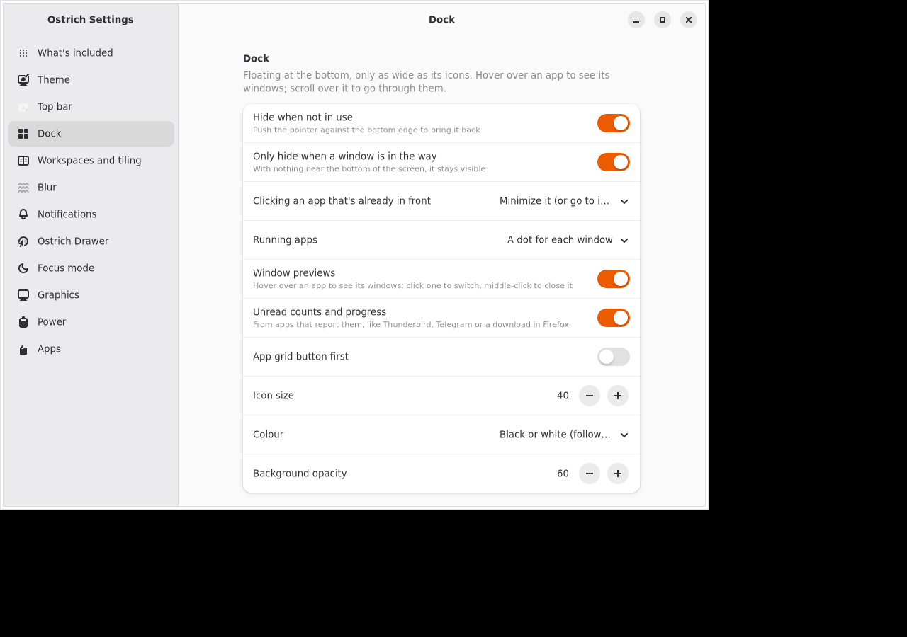

# 02 — First-run tour and Ostrich Settings: a redesign plan for `tools/welcome`

This replaces the earlier plan for a new wizard app driven by an options file. Per the owner's amendment (2026-11-21): the tools are Rust, `tools/welcome` already **is** the tour and Ostrich Settings, whiptail is already only a fallback (`docs/DECISIONS.md`, 2026-10, "Setup UI"), and the design skill and council already exist. So this is **not** a build of a new app. It plans (a) one council session on the tour and Settings, for the owner to approve before it runs, (b) one copy source, and (c) the gaps found in the existing design skill.

Nothing in this file runs until the owner approves it. No code was changed.

## What exists today (audit, `00-audit.md` A1)

- One binary, `ostrich-setup` (`tools/welcome`, gtk4-rs 0.11, libadwaita-rs 0.9, `src/main.rs` 2774 lines, `src/lib.rs` the pure model with unit tests).
- Three ways to open it: `ostrich-setup --tour` (the first-login tour: one window, a sidebar of pages, **Back / Next / Skip the tour** at the bottom, **Finish** on "All set"), no flag (Ostrich Settings: the same pages, no tour buttons, no "All set"), `--step NAME` (one page).
- 15 pages (14 without a hybrid GPU, fewer without a battery, sound card or touchscreen): What's included, Theme, Top bar, Dock, Workspaces and tiling, Blur, Notifications, Ostrich Drawer, Focus mode, Graphics, Power, Speakers, Touchscreen, Apps, All set.
- Rows are bound straight to GSettings (the extensions' own schemas), so changes apply the moment they are made. Nothing is staged and there is no review.
- There is **no preset** (no Recommended / Minimal). The defaults the installer sets are the only "recommended" and are described in `docs/DEFAULTS.md`.
- Row counts: Top bar 18, Windows and tiling 12, Dock 10 (the headless screenshot below shows all ten), Drawer 7 plus site lists, Power several, Blur per-surface rows, Notifications 1.
- Copy lives in Rust string literals in `main.rs`, in each extension's gschema `<summary>`, in `docs/DEFAULTS.md`/`FEATURES.md`/`DESIGN.md` prose, and in `ostrich config`'s help. Four places say the same thing in four wordings.



(The real `ostrich-setup --step dock`, light theme, 100 % text, in a container with no GPU; see the gap list. It already shows a copy problem to bring to the council: the "Clicking an app that's already in front" dropdown text is cut off, "Minimize it (or go to i…".)

## Does `install.sh` need pre-install answers?

**No.** Audit of `install.sh` and `lib/`: the only answer it takes before installing is "keep or clean" the user's other extensions (`choose_mode()`, install.sh:249), and that already has flags (`--keep`, `--clean`) and a safe default. Every module installs the same thing for everyone; the tour changes settings afterwards. So, per the amendment: **no `options.json`, no `jq` dependency, no `choices.json`, no `install.sh --choices`.**

Not a conflict today. It becomes one only if the council decides "Minimal" should mean *fewer things installed* (for example skipping the dev or apps modules) rather than *fewer things switched on*. Then the installer would need an answer before it runs. RECOMMEND the council keep Minimal = fewer things switched on, nothing uninstalled, so the installer stays prompt-free. If the council overrules that: CONFLICT with the amendment's "drop choices.json unless the audit shows install.sh needs pre-install answers" — resolve then, not now.

## One copy source: `tools/welcome/data/copy.toml`

Why: the same wording must appear in the tour, in Settings, in `ostrich config` and in the docs, and it must be reviewable in one file by the council's copy pass.

Format (keyed by extension and gschema key, so every entry is checkable against the schema; the existing `ostrich config` already addresses settings as `EXT KEY`):

```toml
[dock.autohide]
page     = "dock"                  # which Settings page / tour screen it sits on
group    = "Hiding"                # group title on that page
title    = "Hide the dock"         # 5 words or fewer, sentence case, no full stop
summary  = "The dock slides away until you push the pointer to the bottom edge."   # one plain sentence: what changes
detail   = "Frees the bottom of the screen. Turn it off if you often miss the dock."   # optional, 2-3 sentences
recommended = true                 # value in the Recommended preset (the installer's default)
minimal     = true                 # value in the Minimal preset
needs    = ""                      # "", "password", "logout", "password+logout"

[presets.recommended]
title = "Recommended"
summary = "What most people want. You can change anything later."
```

Rules, enforced by `cargo test -p welcome` (pure, in `lib.rs`, no GTK): every entry's `EXT.KEY` exists in that extension's gschema; every user-visible gschema key has an entry or is listed in `[hidden]` with a reason; title ≤5 words and sentence case; summary one sentence, ≤140 characters; no word from the jargon list (below) without a gloss; `recommended` equals the gschema default (so Recommended can never drift from what the installer sets; a test fails if they differ and says which); `needs` agrees with the key's real behaviour (list in the file's header).

Consumers (all read the same embedded file with `include_str!`):

1. **Tour and Settings** (`tools/welcome/src/main.rs`): rows take `title`/`summary` (and an expander for `detail`) from the entry; custom pages (theme cards, speakers A/B, drawer sites, environments) keep their hand-built widgets but take their headings and text from the file.
2. **`ostrich config`** (`tools/ostrich/src/config.rs`): `list` prints the title next to the key; new `ostrich config describe EXT KEY` prints title, summary, detail, default. `tools/ostrich` would depend on the same data (move the file to a small `tools/copy` crate or share the path with `include_str!("../../welcome/data/copy.toml")`; the council need not decide this).
3. **Docs:** `docs/DEFAULTS.md` and the settings tables in `docs/FEATURES.md` are generated from the file (`ostrich config docs > …`), so they cannot disagree with the UI; a CI check fails if the committed file is stale.
4. **gschema `<summary>` stays developer-facing** (what the key does to the code, units, ranges). Never shown to users and not linted for plain language.

The existing text in `main.rs` is the starting content (moved, not rewritten blind); the council's copy pass then edits `copy.toml` only.

Jargon list (initial, the council edits it; each needs a plain phrase or a gloss in the same row): *daemon, sysfs, dconf, gsettings, polkit, ASPM, EPP, RAPL, PL1, intellihide, PRIME, D3cold, userns, AppArmor, sigma, flatpak/snap* (say "app"). Units go in the control, not the title ("Hover delay", control shows "500 ms").

## The method: one council session

Owner approval gate: the session below is **planned only**. `/council` is user-triggered and uses the test VM for about 45 minutes of evidence gathering plus two lab VMs, so nothing starts until the owner says go.

**Agenda** (for `$DEBATE/agenda.md`): "Redesign the first-run tour and Ostrich Settings so a newcomer finishes setup in three screens or fewer, can customise in eight pages or fewer with seven rows or fewer each, and sees every row as a short title plus one plain sentence; nothing needing a password or a restart happens before a review page."

**Seats:** `council-newcomer` (leads), `council-everyday`, `council-simplicity`, `council-design`, `council-access`, and `council-judge`. The command's standing process seats run as usual (`council-researcher` for the facts check between rounds 1 and 2; `council-curator` after round 0). The other advocates do not sit.

CONFLICT: `.claude/commands/council.md` accepts only `--panel full|design|system`. The `design` panel is newcomer, access, owner, design, simplicity, maintainer, which adds the owner and maintainer and lacks everyday. — RECOMMEND: add `--panel tour` (newcomer, everyday, simplicity, design, access) in the command file and in `CLAUDE.md`'s "council" line, as part of the session's setup (a two-line change; the judge, researcher and curator are always included). Until then the clerk can name the seats in the agenda, but the command's panel parsing is what the clerk follows, so make the change first.

**Evidence the session needs** (extend `tests/vm/evidence.sh`, which already screenshots Settings pages at default scale, `settings/$page.png` around line 128, and reuse the 100 %/200 % machinery that `tests/look-check.sh` already runs for the shell's menus via `text-scale-test.sh`):

- Every **tour screen** and every **Settings page**, light and dark, at **100 % and 200 % text** (`org.gnome.desktop.interface text-scaling-factor` 1.0 and 2.0), in the VM. Screenshots go in the evidence pack under `evidence/tour/<page>-<light|dark>-<100|200>.png` and are listed in `index.md`.
- A **step count and row count table** generated from the code (`ostrich-setup --list-pages` prints pages and row counts; new, tiny) for the current design, so the targets have a baseline.
- A **hardware matrix**: hybrid laptop, desktop with no battery, touchscreen, no sound card (the VM can fake these through the existing fixtures in `tools/welcome` tests), because page counts change with hardware.
- The **current copy** exported from `main.rs` to a table (id, page, title, summary) so seats can mark each row; later this is `copy.toml`.
- Timings: how long Recommended takes by keyboard only, from the first screen to Finish.

**Targets the council tests its verdict against** (from the owner; each becomes a pass/fail line in the judge's `tests.md`):

1. The tour opens with a preset choice: **Recommended / Minimal / Customize**.
2. **Recommended finishes in ≤3 screens** (preset, review, done).
3. **Customize ≤8 pages, ≤7 rows each.**
4. Every row is a **short title plus one plain sentence** saying what changes.
5. A **review page appears before anything that needs a password or a restart** is applied. Nothing needing either is applied before Finish/Apply on that page.

**Questions the seats must answer** (so the verdict is a design, not a list of complaints):

- What exactly are Recommended and Minimal (which rows differ, from `copy.toml`)? Recommended must equal the installer's defaults.
- Which settings apply live (harmless, no password) and which are **staged** until the review page? Today the staged set would be Graphics (needs password and log-out), Power hardware settings (password), and the touchscreen toggle (no password, no restart, so probably live). Candidate page grouping to react to, a strawman of 8 from the audit: *Look* (theme, blur), *Top bar*, *Dock*, *Windows* (workspaces, tiling), *Drawer and sites*, *Focus*, *This computer* (graphics, power, speakers, touchscreen: only what's detected), *Apps*. Top bar's 18 rows and Windows' 12 need splitting or collapsing (for example the seven readouts as one expandable row) to hit seven.
- Where do the pages that are *not* options (theme cards, speaker A/B test, drawer sites, environments, recommended apps) sit in "≤7 rows"? (They are custom pages; the verdict must say whether they count.)
- What does Settings look like after the tour (same pages, search, "Reset to recommended", "Run the tour again")? Today Settings has Ctrl+F search; I found no reset-to-recommended.
- Does the tour offer the **browser picker** (when ≥2 browser profiles or ≥1 drawer site, `03-browser-picker.md`) and the **crash help** page (`04-crash-agent.md`), and where?

**Outputs the council produces** (per `docs/council/PROTOCOL.md`): verdict and plan in `docs/council/<date>-the-tour-and-settings.md`; the owner approves; then build tasks come from that plan, not from this file. The build (README step 8) starts only after that approval.

**Design of the tour is the council's job, so this file does not decide it.** Everything under "Questions" and the strawman are inputs.

## Gaps found in the existing `ostrich-design` skill

The skill (`.claude/skills/ostrich-design/`, 101 lines + 6 references) is solid for Shell surfaces and covers libadwaita widgets. Real gaps, found by reading it and by running the headless loop:

1. **No fast, headless screenshot loop for GTK apps.** The skill's checks use VM screenshots (`tests/vm/…`, `tests/vm/contrast.sh`); nothing lets an agent iterate on a `tools/welcome` page in seconds. I proved a container method with the real binary (screenshot above; script `docs/plans/evidence/headless-shot.sh`): Xvfb, `GDK_BACKEND=x11`, `GSK_RENDERER=cairo`, `LIBGL_ALWAYS_SOFTWARE=1`, the built `ostrich-setup`, and the extensions' schemas compiled into `~/.local/share/gnome-shell/extensions/<uuid>/schemas` so the rows appear. Result: **light theme at 100 % text works.**
2. **Dark and 200 % text do not work in that container**, tried and failed: `gsettings set org.gnome.desktop.interface color-scheme/text-scaling-factor` through a session dbus and dconf (screenshots byte-identical to the default), `GDK_DPI_SCALE=2` (no change), `GTK_THEME=Adwaita:dark` (changes the render but drops libadwaita's styling, so it is not representative). libadwaita takes the colour scheme from the settings portal, which a bare container lacks. So dark and large-text checks stay **VM-only**; the skill should say so, and the council's evidence at 100 %/200 % comes from the VM.
3. **No copy rules beyond one line** ("Short, plain, sentence case, no jargon or raw errors", SKILL.md step 4). Missing: title ≤5 words, one-sentence summary saying what changes, buttons are verbs, units in the control, errors say what happened and what to do, a jargon list with plain phrases, one spelling (the repo mixes "colour" with GNOME's American docs; owner to choose). Proposed home: `references/copy.md`, with the mechanical parts enforced by the `copy.toml` test above.
4. **No rule on how many options a page or group may hold**, or on a preset-first flow. The skill says which widget to use, not how many. The amendment's "≤7 rows" and "≤8 pages" belong in the skill once the council confirms them.
5. **The existing text-scale check covers the shell only.** `tests/look-check.sh` runs `text-scale-test.sh` for the clock menu and monitor at 100 % and 200 %; no equivalent for `ostrich-setup` pages, where truncation is visible already (the cut-off dropdown above).
6. **No copy review pass**, i.e. a step that reads every user-facing string (UI, `.desktop` `Name`/`Comment`, notifications, `ostrich` CLI messages) against the rules. Proposed as step 6 of "Check before calling it done".

These are additions to the existing skill (new reference file, a few lines in `SKILL.md`, a VM check), listed here as the amendment asks; **no new skill and no new design-system file is planned.**

## Files to touch (after council approval; this plan itself touches only docs)

`tools/welcome/data/copy.toml` (new), `tools/welcome/src/{lib.rs,main.rs}` (read copy; preset page; review page; page splits; `--list-pages`), `tools/ostrich/src/config.rs` (`describe`, titles in `list`, `docs`), `docs/DEFAULTS.md` and the settings tables in `docs/FEATURES.md` (generated), `.claude/commands/council.md` and `CLAUDE.md` (`--panel tour`), `tests/vm/evidence.sh` (tour and Settings screenshots at 100 %/200 %, light/dark), `tests/vm/text-scale-test.sh` or a sibling (tour/Settings truncation check), `.claude/skills/ostrich-design/{SKILL.md,references/copy.md}`, `docs/DECISIONS.md`.

## Done criteria

1. Council verdict approved by the owner, with `tests.md` showing each of the five targets as proved or not.
2. `cargo test -p welcome` enforces the copy rules, schema coverage and `recommended == default`; CI runs it.
3. The tour on a hybrid laptop fixture: Recommended in ≤3 screens; Customize ≤8 pages, every page ≤7 rows; every row has a title and one sentence from `copy.toml`; a review page lists everything that needs a password or restart, and nothing of that kind has been applied before it.
4. VM screenshots at 100 % and 200 % text, light and dark, show no truncated titles or clipped buttons on any tour screen.
5. `docs/DEFAULTS.md` is generated from `copy.toml` and CI fails if it is stale; `ostrich config describe` prints the same wording as the UI.
6. The skill gaps above are closed in `ostrich-design`, with the VM-only limit for dark and 200 % stated.

## Test method

`cargo test` for the model and copy rules (pure, Docker `ubuntu:26.04` or the host toolchain via `tools/build-tools.sh --check`). Headless container screenshots for quick light/100 % iteration (`docs/plans/evidence/headless-shot.sh`). VM (`tests/vm/ui-test.sh`, `evidence.sh`, `look-check.sh --vm`) for everything else, including dark, 200 % text, keyboard-only runs and the password/restart behaviour. Never the live machine.
