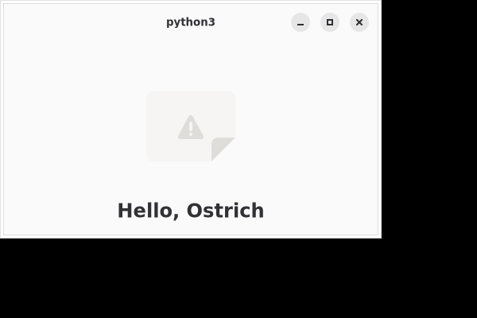

# 05 — Design system doc and design skill

Must be done **before any UI work** in plans 02, 03 and 04.

## Spec (kept as written)

- `docs/DESIGN-SYSTEM.md` from the GNOME HIG (https://developer.gnome.org/hig/) and the libadwaita docs: stock widgets only, no custom CSS beyond the accent; sentence case; buttons are verbs; one primary action per page; ≤7 options per page; every option = title + one-sentence summary; jargon explained or removed; errors say what happened and what to do; light and dark; full keyboard navigation; accessible labels.
- `.claude/skills/ostrich-design/SKILL.md`: triggers on any UI or user-facing copy change; checklist; **mandatory loop**: run the window headless, screenshot to PNG, view it, critique against the checklist, fix, repeat; save finals to `docs/screenshots/`. Pick and document a headless method that works in the `ubuntu:26.04` container (e.g. `GDK_BACKEND=broadway`, or a headless compositor) and prove it with one screenshot of a hello-world libadwaita window.
- Includes a copy-review pass over `options.json`.

## CONFLICTs

CONFLICT: the skill **already exists** at `.claude/skills/ostrich-design/` (SKILL.md 101 lines, 6 references of ~1150 lines total, `contrast.py`, `spec-sheet.py`, `token-lint.sh` run by CI). It already covers GTK4/libadwaita screens *and* GNOME Shell St CSS, with tokens from `tools/icons/palette.toml` and `tokens.toml`, and its rule is "use libadwaita's variables and classes; never hard-code a colour". Creating a new file at that path would overwrite it — RECOMMEND: **extend, don't replace.** Add the headless loop, the copy rules and the new checklist as new sections and `references/copy.md`, `references/headless.md`; keep the St/shell material untouched.

CONFLICT: "stock widgets only, no custom CSS beyond the accent" — the repo ships custom shell surfaces (St widgets in dock, monitor, drawer, tiling) and a **scheme system** that writes `gtk.css` for libadwaita apps (`tools/palette`, `~/.config/gtk-4.0/gtk.css`) and per-extension stylesheets — RECOMMEND: scope the rule to **GTK/libadwaita app windows** (setup wizard, Settings, picker, crash dialogs, Store). Shell extensions stay under the existing St rules. The picker, wizard and consent dialogs use only stock `Adw*` widgets and style classes (`boxed-list`, `suggested-action`, `title-1`…), no app CSS file at all.

CONFLICT: "sentence case" and the repo's British spelling ("colour", "centre") vs GNOME's American English docs and writing guide — RECOMMEND: owner picks once; default **keep British** to match the existing UI and `docs/*`, and add a spelling lint list (`colour|favourite|centre|grey`) only if American is chosen. Either way be consistent within a page.

CONFLICT: `docs/DESIGN.md` principle 7 ("every user-facing feature has a wizard step") and plan 02's "≤7 options per page" — the Top bar page has 18 option rows — RECOMMEND: DESIGN-SYSTEM.md states "≤7 *options per group* shown at once; further options go in a collapsed `AdwExpanderRow` or a sub-page", and the copy pass splits current pages.

CONFLICT: "headless: e.g. `GDK_BACKEND=broadway`" — Broadway renders to a **browser**, so a screenshot still needs a browser; it is not a screenshot method by itself — RECOMMEND: use **Xvfb + `GDK_BACKEND=x11` + software rendering** (proved below), no compositor needed; keep Broadway and a headless `weston`/`mutter --headless` as alternatives only if Wayland-specific behaviour must be shown (it will not be needed for libadwaita widgets).

## Headless screenshot method (proved)

Container: `ubuntu:26.04` (26.04.1). Packages: `python3-gi gir1.2-gtk-4.0 gir1.2-adw-1 xvfb x11-apps imagemagick dbus-x11 adwaita-icon-theme libglib2.0-bin`. Versions seen: python3-gi 3.56.2, GTK 4.22.4, libadwaita 1.9.1, Xvfb 21.1.22, Python 3.14.4.

```bash
export GDK_BACKEND=x11 GSK_RENDERER=cairo LIBGL_ALWAYS_SOFTWARE=1 NO_AT_BRIDGE=1 DISPLAY=:99
Xvfb :99 -screen 0 600x400x24 &            # a virtual screen; no GPU, no compositor, no window manager
sleep 2
python3 hello.py &                          # the window under test (closes itself after 1.5 s)
sleep 1.2
import -window root out.png                # ImageMagick grabs the whole virtual screen
```

Files: `docs/plans/evidence/hello.py` (the window), `docs/plans/evidence/shot.sh` (the whole run). Proof: `docs/screenshots/hello-libadwaita.png` (a libadwaita `AdwStatusPage` with a header bar and a suggested-action pill button).



What this proof shows and does not show — read the PNG before trusting the method:

- It **works**: real libadwaita 1.9 styling renders in the container with no display.
- Window title shows `python3` (no `.desktop` app id match) and the header controls are drawn by GTK's client-side decorations — fine for widgets, not representative of the GNOME Shell window chrome.
- **Two defects in the proof, causes not yet confirmed:** the status icon rendered as a generic "missing image" placeholder although `adwaita-icon-theme` was installed (likely an icon-theme lookup or cache problem in the minimal container; try `gtk4-update-icon-cache` or a different icon name), and the window was cut off at the bottom: the 300 px default height left the primary button out of the frame (there is no window manager, so nothing resizes the window; the grab may also have run before the final layout). Fix for the real loop: a larger screen (e.g. 1280×800), a taller `default_height`, wait for the first frame (`GLib.idle_add` after `present()` plus a short sleep), install icon themes as needed, and screenshot one specific window (`xwininfo`/`import -window <id>`), or render the widget in-process (`Gtk.WidgetPaintable` → `Gsk.Renderer` → PNG) to avoid needing X at all.
- The proof was one screenshot; **dark mode, scaling and RTL were not shown.** The loop below does them by setting `Adw.StyleManager` colour scheme in the harness (`Adw.StyleManager.get_default().set_color_scheme(Adw.ColorScheme.FORCE_DARK)`), `GDK_SCALE=2`, and `LANG=he_IL.UTF-8` (locale installed) for RTL.
- Fonts: the container has few fonts; text metrics differ from a real Ubuntu install (Ubuntu Sans). Install `fonts-ubuntu`/`fonts-ubuntu-sans`-equivalent from the archive for realistic widths, and treat contrast numbers (computed on the PNG with the existing `tests/vm/contrast.sh` / `contrast.py`) as valid, pixel widths as approximate. Final sign-off screenshots for the repo come from the **VM** (real GNOME 50) per `CLAUDE.md`.

## Deliverables

### 1. `docs/DESIGN-SYSTEM.md`

Distilled, citable, short (target ≤ 300 lines), each rule with its source URL and the date read. Sections: 1 Scope (GTK/libadwaita app windows only; shell surfaces defer to the existing St rules) · 2 Principles · 3 Widgets (stock list: `AdwWindow`, `AdwNavigationView`, `AdwPreferencesPage/Group`, `AdwActionRow`, `AdwSwitchRow`, `AdwComboRow`, `AdwSpinRow`, `AdwExpanderRow`, `AdwAlertDialog`, `AdwToast`, `AdwStatusPage`, `AdwBanner`, `GtkSearchEntry`, `GtkListBox.boxed-list`; and "not allowed": custom drawn widgets, app-level `GtkCssProvider`, hex colours, fixed font sizes) · 4 Colour (accent only through libadwaita `--accent-*`; light and dark both checked; ≥4.5:1 text, ≥3:1 UI parts; never colour alone) · 5 Copy (below) · 6 Layout (one primary action per page, ≤7 options per group, 480–720 px max content width, 12 px grid via libadwaita spacing) · 7 Keyboard and accessibility (Tab order, mnemonics, `Ctrl+F` search, Esc closes dialogs, focus visible, accessible names/descriptions on every icon-only control, no keyboard traps, respects reduced motion and text scale up to 200 %) · 8 Errors and empty states · 9 Checklist (the skill copies it).

Sources to read and cite: HIG (https://developer.gnome.org/hig/), libadwaita docs (https://gnome.pages.gitlab.gnome.org/libadwaita/doc/), GNOME writing style, WCAG 2.2. Conflict rule from `CLAUDE.md` applies: current GNOME 50 / libadwaita 1.9 docs win over older text.

### 2. Copy rules (go in DESIGN-SYSTEM.md §5 and `references/copy.md`)

1. **Sentence case** everywhere (titles, buttons, headers); product names keep their case.
2. **Buttons are verbs** ("Install", "Restore default", "Log out now"), not "OK/Yes/No"; destructive ones say what is destroyed ("Remove site").
3. **Option = title (≤5 words) + one-sentence summary** (≤140 chars) saying *what changes on the computer*, in the present tense, plain words. A tradeoff goes in `detail` (2–3 sentences).
4. **No jargon without a gloss.** Banned or replaced unless explained in the same row: *daemon, sysfs, dconf, gsettings, polkit, ASPM, EPP, RAPL, PL1, intellihide, sigma, PRIME, D3cold, userns, AppArmor, flatpak/snap (say "app")*. A glossary table in `references/copy.md` maps each to a plain phrase.
5. **Errors:** *what happened* + *what to do*, no blame, no codes first ("Couldn't open the link. It was opened in your last browser instead. Check Settings → Browser."). Technical detail only in an expander or the log.
6. **No ellipsis for work in progress**, use it only when a button opens a further dialog.
7. **Numbers with units in the control**, not the title.
8. **Consistency:** the same thing has the same name everywhere ("Ostrich Settings", "Ostrich Drawer", "the dock").
9. **Second person, active voice**, no exclamation marks, no "please", no "simply/just/easy".

### 3. SKILL.md changes (extend `.claude/skills/ostrich-design/SKILL.md`)

- **Description / triggers** — add: "any change to a GTK/libadwaita window, dialog, notification text, `options.json`, `.desktop` file strings, CLI messages shown to users, or release notes".
- **Checklist** (must be answered "yes/N/A" with evidence in the PR description or commit message): stock widgets only · sentence case · buttons are verbs · one primary action · ≤7 options per group · every option has title + one sentence · jargon explained or removed · errors say what happened and what to do · light **and** dark screenshots checked · keyboard-only run-through done (list the keys) · accessible names on icon-only controls · text scale 150 % checked · RTL not broken · contrast ≥4.5:1 computed.
- **Mandatory loop** (the skill says "do not stop after the first screenshot"):
  1. Build the smallest runnable harness for the window (`tools/<app>/--screenshot PAGE` flag or a tiny script that constructs just that page; **no sample data from the real home**).
  2. Run headless via `tests/ui/shot.sh <app> <page> [--dark] [--scale 2] [--rtl]` (new wrapper around the Xvfb method: starts Xvfb, runs the window, crops to the window, writes `$OUT/<page>-<mode>.png`).
  3. **View the PNG** (the Read tool shows images) — never judge from code alone.
  4. Critique against the checklist, writing each finding as `page · what's wrong · rule`.
  5. Fix, rerun from step 2. At least two passes; stop when a pass produces no findings.
  6. Run `scripts/contrast.py` on the final PNG and `scripts/token-lint.sh`.
  7. Save finals to `docs/screenshots/<plan>-<page>-<light|dark>.png` (final images only; ≤200 KB each; no personal data) and reference them from the plan or PR.
- **Copy-review pass** — a numbered review of every string: run `tests/options-lint.sh` (mechanical: word count, case, length, banned words), then a human-style read-through by the skill itself against §5, listing each change as `id: old → new`. Applies to `options.json`, `.desktop` `Name`/`Comment`, notification text, dialogs, CLI output. Run it on the existing text first: the audit already found six over-long titles and unit-in-title rows (`00-audit.md` A1).
- Keep the existing "which surface" table and add a third row: *Setup wizard, picker, crash dialogs* → GTK4/libadwaita, read `references/copy.md` and `references/headless.md`.

### 4. Scripts and docs to add

`tests/ui/shot.sh` (Xvfb wrapper; installs nothing; takes `--dark|--light`, `--scale N`, `--rtl`, `--size WxH`), `tests/ui/Dockerfile` (just the packages above, pinned base `ubuntu:26.04`), `tests/options-lint.sh` (shared with plan 02), `.claude/skills/ostrich-design/references/{copy.md,headless.md}`, `docs/screenshots/` (already used for the proof), CI job `ui-shots` (renders the hello window plus each existing page headless and fails if the process exits non-zero or the PNG is blank (stddev ≈ 0)).

## Files to touch

`docs/DESIGN-SYSTEM.md` (new), `.claude/skills/ostrich-design/SKILL.md` (edit), `.claude/skills/ostrich-design/references/copy.md` and `headless.md` (new), `tests/ui/shot.sh`, `tests/ui/Dockerfile`, `tests/options-lint.sh`, `.github/workflows/ci.yml` (job), `docs/DESIGN.md` (link to the design system, resolve the 7-options rule), `docs/DECISIONS.md` (spelling decision, headless method decision).

## Done criteria

1. `docs/DESIGN-SYSTEM.md` exists, every rule cites a source and a date, and a reviewer can run the checklist on a page in under 5 minutes.
2. The skill triggers on a UI/copy change (test: ask for "rename a button in Settings" in a fresh session and confirm the skill is loaded) and the loop runs end to end in Docker on the existing wizard's *Dock* page: two screenshots (light, dark) viewed and critiqued, findings recorded.
3. `tests/ui/shot.sh` produces a non-blank PNG in the `ubuntu:26.04` container for the hello window **at full window size** (fixes the cut-off in the first proof) and for dark and 2× scale.
4. The copy-review pass has been run over a draft `options.json` and its list of `old → new` changes is committed.
5. Existing `token-lint.sh` still passes; the shell-extension guidance in the skill is untouched (diff shows only additions to those sections).

## Test method

Docker `ubuntu:26.04` (`tests/ui/Dockerfile`): hello window screenshots, shot.sh flags, lint scripts, `shellcheck`/`bats`. VM: the real wizard/Settings screens for final screenshots on GNOME 50 (fonts, theme and chrome are real there). Never the live machine.
